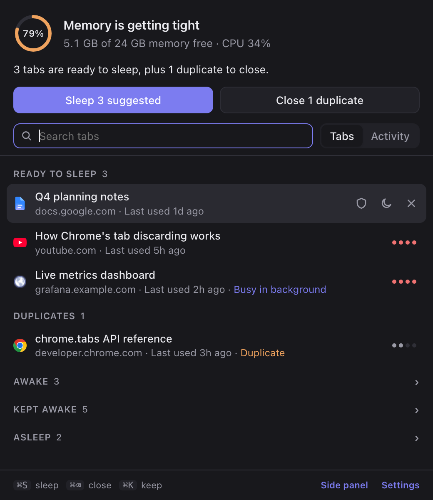
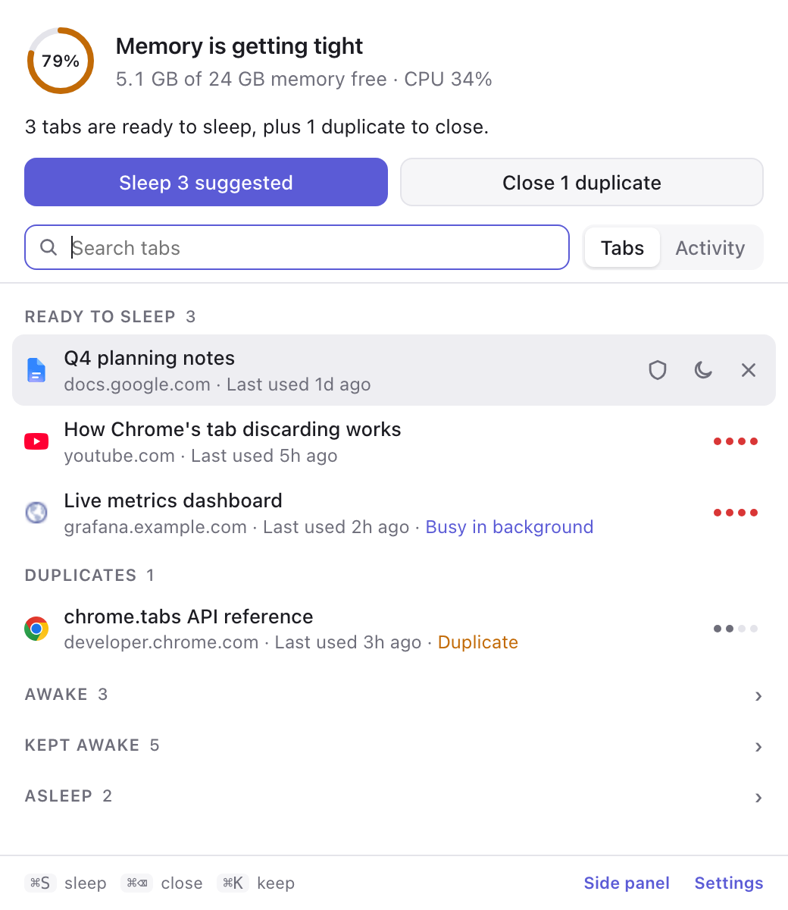

# Doze

**A Chrome extension that puts the tabs you aren't using to sleep, so Chrome gives their memory back.**

A sleeping tab stays in your tab strip with its title and icon. Click it and it reloads. Doze decides which tabs can sleep, explains why, measures what it freed, and learns when it gets one wrong.

**[Add Doze to Chrome](https://chromewebstore.google.com/detail/lccdmcfibfkkajldbmcnomeiddbedihg)** · free on the Chrome Web Store

<p align="center">
  
  
</p>

## Why

With dozens of tabs open, Chrome can make a Mac with plenty of RAM feel slow. Chrome's Memory Saver helps, but it works quietly and on its own schedule. Doze shows what's going on and lets you act on it in one keystroke.

## Features

- **Ranks every tab** by how long since you used it, whether it duplicates another tab, how heavy or busy it is, and how often you use the site. Each tab says why it's ranked where it is.
- **Sleeps tabs in bulk or one by one.** Use the popup, the side panel, the right-click menu or keyboard shortcuts.
- **Auto-sleep.** Every 5 minutes it sleeps tabs idle past your limit (1 hour by default).
- **Closes duplicates** and keeps the copy you used last.
- **Honest numbers.** It shows your Mac's memory and CPU, measures how much memory each action actually freed, and estimates savings only from those measurements.
- **Activity log with Undo** for an hour. Undo wakes slept tabs or reopens closed ones.
- **Learns from mistakes.** Reopen a tab within 15 minutes of Doze sleeping it, and that site gets more time before it's slept again.
- **Hunger meter (opt-in).** One to four dots per tab, from the page's real memory use and background work.
- **Never loses your work.** With the hunger meter on, a tab with a half-written message is never slept.
- **Popup or side panel.** It's one view in two places; Settings can make the toolbar icon open the panel.

## Install

Install it from the **[Chrome Web Store](https://chromewebstore.google.com/detail/lccdmcfibfkkajldbmcnomeiddbedihg)**. Requires Chrome 121 or later.

### From source

To build it yourself you need [Bun](https://bun.sh).

```bash
git clone https://github.com/SnehanChakravarthi/doze.git
cd doze
bun install
bun run build
```

Then open `chrome://extensions`, turn on **Developer mode**, click **Load unpacked** and choose the `dist` folder. After pulling changes, run `bun run build` again and press the reload arrow on Doze's card.

## Using it

| Where | Action |
| --- | --- |
| Toolbar icon or **⌥⇧D** | Open Doze |
| **⌥⇧S** | Sleep the tabs you've multi-selected (Cmd/Shift-click in the tab strip) |
| **⌥⇧O** | Sleep every other tab in the window |
| Right-click a page or the icon | The same actions, plus "Close duplicate tabs" |
| In Doze | Type to search · `↑↓` move · `↵` open · `⌘S` sleep · `⌘⌫` close · `⌘K` keep a site awake |

Change the Chrome-wide shortcuts at `chrome://extensions/shortcuts`.

## How tabs are ranked

`src/scoring.ts` gives every tab a score from 0 to 100. A score of 40 or more means "Ready to sleep". Duplicates are offered for closing instead.

| Signal | Effect |
| --- | --- |
| Time since you last used it | up to +60 (log curve, maxes out at 8 h) |
| Duplicate of another open tab | +30, and the copy you used last is kept |
| Heavy (JS heap ≥ 120 MB when measured, otherwise a usually-heavy site), idle 10 min+ | +10 |
| Busy in the background (≥ 300 ms of long tasks per minute) | +15 |
| A site you use often (decaying count, 3-day half-life) | −15, and 3× longer before auto-sleep |
| A site you reopened soon after Doze slept it (14-day half-life) | up to −30, and longer before auto-sleep |

Doze never sleeps these on its own:

- the tab you're on
- tabs playing audio
- tabs with unsaved typing
- pinned tabs (you can turn this off)
- sites you keep awake
- tabs Chrome marks as not discardable

You can still sleep or close pinned and kept-awake tabs yourself.

## Privacy

Everything runs on your machine. Doze has no server, analytics or network requests.

- **Default permissions:**
  - **tabs**: titles and URLs, to rank tabs
  - **storage**: settings and the activity log, kept locally
  - **alarms**: the 5-minute auto-sleep check
  - **contextMenus**: the right-click menu
  - **favicon**: tab icons
  - **system.memory** and **system.cpu**: the Mac vitals
  - **scripting** and **sidePanel**: the hunger meter and the panel
- **The hunger meter is opt-in.** Turning it on asks for access to all sites; Chrome words this as "read and change all your data". [`src/probe.ts`](src/probe.ts) only measures three things:
  - how much memory the page's JavaScript holds (`performance.memory`, which Chrome rounds and refreshes slowly)
  - how much long-running work the page does while hidden
  - whether a field you typed into still has text in it

  It ignores password and search fields, and it never reads out or sends what you typed. You can turn it off in Settings at any time, which removes the access.

## Develop

```bash
bun test           # scoring, vitals and activity logic
bun run typecheck  # strict TypeScript
bun run build      # bundles src/ into dist/
```

| File | What it does |
| --- | --- |
| `src/scoring.ts` | Pure ranking logic: scores, protections, duplicates, hunger levels |
| `src/tabs.ts` | Chrome-facing layer: snapshots, sleep/close/undo, learning, probes, badge |
| `src/background.ts` | Service worker: alarms, shortcuts, context menu, messages from the popup |
| `src/popup.ts` | The popup and side panel UI |
| `src/probe.ts` | The opt-in in-page measurement script |
| `src/system.ts` | Mac memory and CPU readings and wording |
| `src/activity.ts` | Activity log types, undo window, savings estimates |

The logic in `scoring.ts`, `system.ts` and `activity.ts` makes no `chrome.*` calls, so it's unit-tested directly with `bun test`.

## Roadmap

- Group tabs by task with Chrome's on-device AI (Gemini Nano), and sleep or save whole groups
- Saved sessions: close a group of tabs now, restore it later in one click
- Typed commands, like "sleep everything except work"

## License

[MIT](LICENSE)
